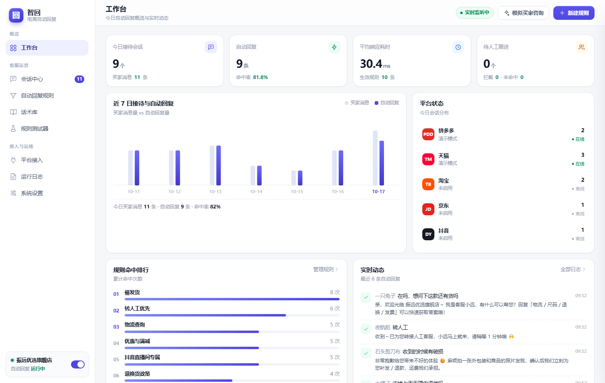
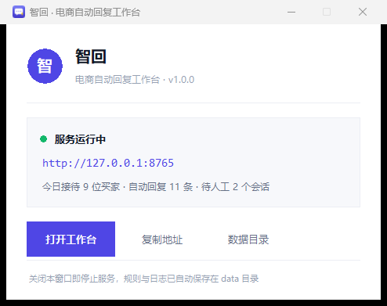

# 智回 · 电商自动回复工作台

[](https://github.com/355744444-source/ecom-autoreply/releases/latest)
[](#快速开始)
[](https://www.python.org/)
[](#设计说明)

面向中国电商多平台店铺的本地自动回复工具，覆盖 **拼多多 / 天猫 / 淘宝 / 京东 / 抖音**。
核心是「关键词规则引擎 + 自定义话术 + 人工接管」，全部数据保存在本机 SQLite，不上传云端。



---

## 快速开始

**方式一（推荐，零依赖）**：从 [Releases](https://github.com/355744444-source/ecom-autoreply/releases/latest) 下载 `ZhiHui-v1.0.0-Windows-x64.exe`，双击运行

单文件 14.3 MB，内置 Python 运行时与全部前端资源，**目标电脑不需要装 Python**。
双击后弹出控制窗口 → 自动打开浏览器 → 页面即可用；关闭窗口即停止服务。



**方式二**：源码运行

```bash
python app.py                 # 自动打开浏览器
python app.py --no-open       # 只启动服务
python app.py --port 9000     # 指定端口
```

**方式三**：源码目录下双击 `启动.bat`

浏览器会打开 `http://127.0.0.1:8765`（端口被占用时自动顺延）。
默认进入**演示模式**：内置模拟买家消息流，不需要任何平台授权即可完整体验规则命中、自动回复、人工接管全流程。

---

## 功能一览

| 模块 | 能力 |
|---|---|
| 工作台 | 今日接待量、自动回复数、命中率、平均响应耗时、待人工跟进；近 7 日趋势、平台状态、规则命中排行、实时动态 |
| 会话中心 | 三栏布局（会话列表 / 聊天窗 / 买家资料）；自动回复与人工消息区分标记；一键转人工、恢复自动；快捷话术一键插入 |
| 自动回复规则 | 规则 CRUD、四种匹配方式、优先级排序、按平台生效、生效时段、变量渲染、启停开关、实时预览 |
| 话术库 | 按分类管理标准话术，支持变量、复制、编辑、删除；会话页可直接调用 |
| 规则测试器 | 输入买家原话，立即看到命中规则、命中关键词高亮、最终发送内容、执行链路 |
| 平台接入 | 五个平台独立配置（演示模式 / 官方接口），App Key、App Secret、店铺名、启停 |
| 运行日志 | 全部回复记录可追溯，按平台与状态筛选、关键词搜索、CSV 导出 |
| 系统设置 | 总开关、工作时段、夜间策略、发送延迟、频率限制、同会话冷却、人工接管静默、敏感词拦截、签名 |

---

## 自定义回复怎么配

进入「自动回复规则」→ 右上角「新建规则」，或按 `Ctrl` 之外的任意场景点「新建规则」。

| 字段 | 说明 |
|---|---|
| 规则名称 | 内部标识，建议按场景命名，如「物流查询」「尺码推荐」 |
| 匹配方式 | `包含任一`（最常用）/ `包含全部` / `完全匹配` / `正则匹配` / `兜底` |
| 关键词 | 每行一个，或用逗号分隔。买家消息命中任一关键词即触发 |
| 优先级 | 数字越大越先匹配。建议：转人工 100、催发货 95、物流 90、兜底 1 |
| 适用平台 | 多选；不选表示全部平台生效 |
| 生效时段 | 如 `09:00-22:00`，支持跨零点 `22:00-08:00`；留空表示全天 |
| 回复内容 | 支持变量与多行文本，保存前可在「实时预览」看到渲染结果 |

### 可用变量

| 变量 | 含义 | 变量 | 含义 |
|---|---|---|---|
| `{昵称}` | 买家昵称 | `{商品名}` | 咨询商品 |
| `{店铺}` | 店铺名称 | `{订单号}` | 订单号 |
| `{客服名}` | 客服昵称 | `{物流状态}` | 物流状态 |
| `{平台}` | 来源平台 | `{时间}` / `{日期}` | 当前时间 / 日期 |

> 变量未取到值时会渲染成 `—`，不会把 `{xxx}` 原样发给买家。

### 匹配示例

```
规则：物流查询   优先级 90   关键词：物流 / 快递 / 到哪了
买家：我的快递到哪了，都三天了
结果：命中「物流查询」，命中词 快递、到哪了
```

无规则命中时，若开启「兜底回复」则使用兜底话术；否则该消息标记为「未命中」进入人工待处理。

---

## 平台接入

五个平台都必须走**官方开放平台的客服消息能力**（商家授权 + 应用审核）。本工具不模拟客户端、不注入进程、不改注册表，避免账号被风控。

| 平台 | 开放平台 | 需要的权限 |
|---|---|---|
| 拼多多 | 拼多多开放平台 | 客服消息推送订阅（client_id / client_secret） |
| 天猫 / 淘宝 | 淘宝开放平台 TOP | 天猫商家客服类目应用、qimen 消息服务 |
| 京东 | 京东宙斯开放平台 | 咚咚客服接口、access_token |
| 抖音 | 抖店开放平台 | 飞鸽客服 IM 消息事件（回传有 5 秒时限） |

在「平台接入」页填入 App Key / App Secret 并把接入方式切到「官方接口」即可保存配置。
当前版本内置的是**适配器骨架**：`simulator.py` 中的 `Dispatcher.dispatch()` 就是统一的消息处理管线，
真实接入时只需把消息来源从模拟器换成开放平台的推送/拉取，规则引擎、日志、会话全部复用。

> 注意：各平台对「自动回复」有明确的频率与内容规范，请勿用于刷屏、诱导好评等违规场景，
> 否则可能触发平台处罚。工具的频率限制、敏感词拦截、人工接管静默就是为此设计的。

---

## 目录结构

```
ecom-autoreply/
├─ dist/智回.exe       构建产物（不入库；可直接下 Releases 或按下方命令构建）
├─ app.py              启动入口（选端口 + 控制窗口 + 打开浏览器）
├─ server.py           HTTP 服务与 REST API（仅标准库）
├─ engine.py           规则引擎：匹配、优先级、时段、变量、敏感词
├─ simulator.py        消息流模拟器 + 统一回复管线 Dispatcher
├─ db.py               SQLite 建表、种子数据、历史演示数据
├─ selftest.py         自检脚本（引擎单测 + 接口冒烟）
├─ 智回.spec           PyInstaller 打包配置（单文件 / 无控制台）
├─ version_info.txt    exe 版本资源（公司名、产品名、版本号）
├─ assets/             应用图标 + 图标生成脚本
├─ 启动.bat            源码方式双击启动
├─ data/app.db         本地业务数据（首次运行自动生成，不入库）
└─ web/
   ├─ index.html       单页应用骨架
   ├─ css/app.css      设计系统与全部样式
   └─ js/app.js        页面路由、渲染、交互、轮询
```

## 数据存储

- 全部数据在 `data/app.db`（SQLite），**删除即恢复出厂演示数据**。
- **exe 版的数据目录在 exe 同级**：`<exe 所在目录>\data\app.db`。控制窗口上点「数据目录」可直接打开。
- 分发时只需给一个 exe，首次运行会自动创建 `data\` 并写入演示数据。
- 迁移/备份：直接复制 `app.db`（连同 `-wal`、`-shm` 文件一起复制更稳妥）。
- 「系统设置 → 重置演示数据」只清会话与消息；「清空运行日志」只清日志。

## 自检

```bash
python selftest.py            # 引擎单测；若服务在跑，自动追加接口测试
python selftest.py --api 8765 # 指定端口（对 exe 版同样适用）
```

覆盖：关键词命中、优先级抢占、平台隔离、生效时段、变量渲染、敏感词拦截、正则/完全匹配、
规则增删改查与参数校验、日志分页、实时流游标。当前 **26 项全部通过**。

## 打包成单文件 exe

```bash
pip install pyinstaller
pyinstaller 智回.spec --clean --noconfirm --distpath dist --workpath build
```

产物 `dist\智回.exe`（约 15 MB），参数含义：

| 配置 | 作用 |
|---|---|
| `console=False` | 不弹黑窗，双击直接出控制窗口 |
| `datas=[('web','web')]` | 前端资源打进 exe，运行时从 `sys._MEIPASS` 读取 |
| `excludes=[...]` | 排除 numpy / pandas / PIL 等重型库，体积从 40 MB 降到 15 MB |
| `icon=` / `version=` | 应用图标与文件属性（右键 exe → 属性 → 详细信息可见公司名与版本） |

运行期资源路径与数据路径已分开处理：`web` 走临时解包目录 `sys._MEIPASS`，
`data` 落在 `os.path.dirname(sys.executable)`，保证单文件模式下数据不会随进程退出丢失。

控制窗口做了 per-monitor DPI 感知，在 125% / 150% 缩放下文字不会发虚；重复双击时
检测到已有实例在运行会直接唤起浏览器，不会起第二个进程。

---

## 设计说明

- **视觉**：Indigo 主色 + 中性灰阶，浅色 SaaS 风格；平台色仅用于身份标识（拼多多红 / 天猫红 / 淘宝橙 / 京东红 / 抖音黑）。
- **字体**：`PingFang SC / Microsoft YaHei UI`，数字使用等宽数字特性，表格对齐稳定。
- **交互**：所有破坏性操作二次确认；规则表单带实时预览，保存前即可看到买家会收到什么；轮询刷新只替换消息区，不会打断正在输入的回复。
- **可访问性**：全部表单有可见焦点环，开关与图标按钮带 `title`，颜色对比度满足 WCAG AA 正文要求。
- **无外部依赖**：后端只用 Python 标准库，前端零框架零 CDN，断网可用。
